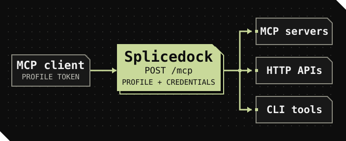
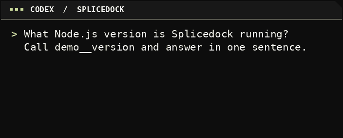
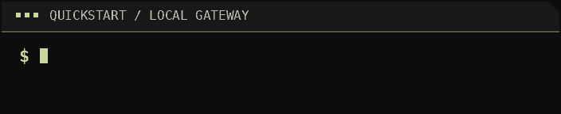
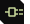
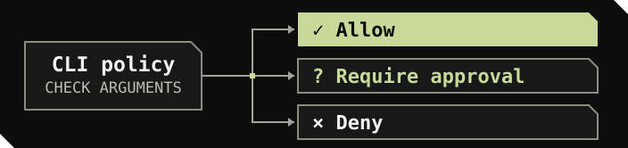
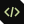
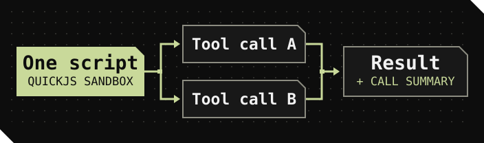
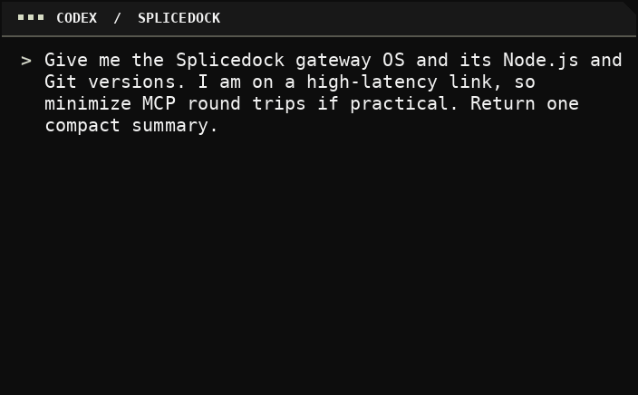

<h1 align="center">
  <picture>
    <source media="(prefers-color-scheme: dark)" srcset="site/assets/splicedock-logo-dark.svg">
    
  </picture>
</h1>

<p align="center">Connect MCP servers, HTTP APIs, and command-line tools through one MCP endpoint.</p>

<p align="center"><code>v1.1.1</code></p>

<p align="center">
  <a href="https://kamilrybacki.github.io/splice-dock/start.html"><strong>Quickstart</strong></a> ·
  <a href="https://kamilrybacki.github.io/splice-dock/tools.html#drivers">Integration examples</a> ·
  <a href="https://kamilrybacki.github.io/splice-dock/">User guide</a>
</p>

<p align="center">
  
</p>

<details>
<summary>Contents</summary>

- [How it works](#how-it-works)
- [Quickstart](#quickstart)
- [Install](#install)
- [Connect your tools](#connect-your-tools)
- [Run a Code Mode workflow](#run-a-code-mode-workflow)
- [Operate the gateway](#operate-the-gateway)
- [Develop locally](#develop-locally)

</details>

## How it works

Each Model Context Protocol (MCP) client connects to `/mcp` with a bearer
token. The token selects a profile that determines which tools the client can
discover and call. You manage profiles, credentials, and approvals at the gateway.



### Watch an agent call a tool

Ask Codex for the gateway’s Node.js version. It calls `demo__version` through
Splicedock and answers from the result. This replay comes from a local run.

<picture>
  <source media="(prefers-reduced-motion: reduce)" srcset="docs/assets/agent-demo.png">
  
</picture>

[Read the final frame](docs/assets/agent-demo.png) ·
[Connect your own MCP client](https://kamilrybacki.github.io/splice-dock/connect.html)

## Quickstart

Install Git, Node.js 22, and npm. Use a local machine with ports `8788` and
`8789` available. The demo exposes `demo__version`, a read-only tool that
prints the gateway’s Node.js version.

```bash
git clone https://github.com/kamilrybacki/splice-dock.git splicedock
cd splicedock
npm ci
npm run build
```

Run the next block from the checkout. It uses a temporary database and stops
the gateway when the example finishes. The demo configuration disables strong
consent for this local run.

```bash
(
  demo_dir="$(mktemp -d)" || exit 1
  export SPLICEDOCK_CONFIG="$PWD/site/examples/quickstart.yaml"
  export SPLICEDOCK_DB_PATH="$demo_dir/splicedock.db"
  export SPLICEDOCK_ADMIN_TOKEN="$(node -e 'console.log(require("node:crypto").randomBytes(32).toString("hex"))')"

  node dist/main.js > "$demo_dir/gateway.log" 2>&1 &
  gateway_pid=$!
  trap 'kill "$gateway_pid" 2>/dev/null; wait "$gateway_pid" 2>/dev/null; rm -f "$demo_dir"/splicedock.db* "$demo_dir/gateway.log"; rmdir "$demo_dir"' EXIT

  node site/examples/first-call.mjs || { cat "$demo_dir/gateway.log" >&2; exit 1; }
)
```

The example creates a short-lived profile token, lists tools, calls
`demo__version`, and revokes the token. The result should match `node --version`.

<picture>
  <source media="(prefers-reduced-motion: reduce)" srcset="docs/assets/quickstart-result.svg">
  
</picture>

To leave the demo running and connect your own client, follow the
[Quickstart guide](https://kamilrybacki.github.io/splice-dock/start.html) and
[issue a profile token](https://kamilrybacki.github.io/splice-dock/connect.html#create-token).

## Install

Splicedock ships as an npm package for bare-metal hosts and as a container
image. Both read the same configuration file and environment variables.

| Variable | Default | Purpose |
| --- | --- | --- |
| `SPLICEDOCK_CONFIG` | `/etc/splicedock/splicedock.yaml` | Gateway configuration file |
| `SPLICEDOCK_DB_PATH` | `/var/splicedock/data/splicedock.db` | SQLite database |
| `SPLICEDOCK_BIN` | `/var/splicedock/bin` | Directory for CLI tool binaries |
| `SPLICEDOCK_ADMIN_TOKEN` | none (required) | Bearer token for the admin API and UI login |

Start from the [annotated configuration](splicedock.example.yaml). The MCP
endpoint listens on port `8788` and the admin UI on port `8789`.

### npm (bare metal)

Requires Node.js 22 or later.

```bash
npm install -g splicedock
mkdir -p "$HOME/splicedock"
cp "$(npm root -g)/splicedock/splicedock.example.yaml" "$HOME/splicedock/splicedock.yaml"
# Edit splicedock.yaml for your tools, then:
export SPLICEDOCK_CONFIG="$HOME/splicedock/splicedock.yaml"
export SPLICEDOCK_DB_PATH="$HOME/splicedock/splicedock.db"
export SPLICEDOCK_BIN="$HOME/splicedock/bin"
export SPLICEDOCK_ADMIN_TOKEN="$(node -e 'console.log(require("node:crypto").randomBytes(32).toString("hex"))')"
splicedock
```

If the install fails with `node-gyp rebuild` and "Could not find any Python
installation", add `--ignore-scripts`. `better-sqlite3` ships prebuilt binaries
and does not need the build, but npm still starts it
([npm/cli#9837](https://github.com/npm/cli/issues/9837)).

To try it without installing, run `npx splicedock`. The package includes the
Quickstart configuration at `$(npm root -g)/splicedock/site/examples/quickstart.yaml`
and the annotated example at `$(npm root -g)/splicedock/splicedock.example.yaml`.
To move an existing SQLite database to PostgreSQL, run
`splicedock db migrate-sqlite-to-pg --sqlite <path>` with `SPLICEDOCK_DB_DSN` set.

### Container

```bash
export SPLICEDOCK_ADMIN_TOKEN="$(openssl rand -hex 32)"
docker run --rm \
  -p 8788:8788 -p 8789:8789 \
  -e SPLICEDOCK_ADMIN_TOKEN \
  -v "$PWD/splicedock.yaml:/etc/splicedock/splicedock.yaml:ro" \
  -v splicedock-data:/var/splicedock/data \
  ghcr.io/kamilrybacki/splice-dock:v1.1.1
```

Each tagged release publishes a multi-architecture image with an SBOM and
build provenance. Pass secrets with `-e` or `--env-file`, never in the
configuration file.

From v1.1.0 the image runs the gateway as the `node` user (UID 1000). On
start the entrypoint gives `/var/splicedock/data` and `/var/splicedock/bin` to
that user, which also covers volumes written by v1.0.0. Files you mount, such
as SSH keys or a kubeconfig, must be readable by UID 1000. With `--user` or a
Kubernetes `runAsUser`, the image runs as that user and leaves ownership to
you.

## Connect your tools

Start with the [annotated configuration](splicedock.example.yaml). Add the tool
to the gateway configuration, then add its exposed MCP name to the client’s
[profile manifest](https://kamilrybacki.github.io/splice-dock/profiles.html#manifest).

| Driver | Use it to | Example |
| --- | --- | --- |
| `mcp_proxy` | Forward calls to an existing MCP server | [Look up a product with `catalog__lookup_product`](https://kamilrybacki.github.io/splice-dock/tools.html#mcp) |
| `http` | Wrap one HTTP API operation as a tool | [Map an argument into a URL with `catalog__product`](https://kamilrybacki.github.io/splice-dock/tools.html#http) |
| `cli` | Run a fixed executable with a declared argument template | [Read the Node.js version with `demo__version`](https://kamilrybacki.github.io/splice-dock/tools.html#fixed-cli) |
| `cli_passthrough` | Run an allowlisted executable with a caller-supplied argument array | [Allow `git version` and deny `git status` with `git__run`](https://kamilrybacki.github.io/splice-dock/tools.html#cli) |

CLI passthrough checks its policy before running the command. A rule can allow
the call, deny it, or require an
[approval](https://kamilrybacki.github.io/splice-dock/policies.html#approval).



For backends that need credentials, configure a
[gateway credential binding](https://kamilrybacki.github.io/splice-dock/credentials.html)
separately from the client’s profile token.

## Run a Code Mode workflow

The Quickstart profile enables Code Mode. In an MCP client connected to that
profile, send this JavaScript function body as the `code` argument to
`code_mode__execute`.

```js
const response = await tools.call("demo__version", {});
return { ok: !response.isError, output: response.content };
```

<details>
<summary>View the full MCP request</summary>

Send this request through an initialized MCP client using the Quickstart profile token.

```json
{
  "jsonrpc": "2.0",
  "id": 1,
  "method": "tools/call",
  "params": {
    "name": "code_mode__execute",
    "arguments": {
      "code": "const response = await tools.call(\"demo__version\", {});\nreturn { ok: !response.isError, output: response.content };"
    }
  }
}
```

</details>

The workflow returns the tool result and a call summary. Each call uses the
same profile and policies as a direct MCP call. The JavaScript runs in QuickJS
with tool calls mediated by the gateway. See the
[Code Mode guide](https://kamilrybacki.github.io/splice-dock/code-mode.html)
for parallel calls, resource limits, and optional preflight review.



### See an agent choose Code Mode

Ask for the gateway’s OS, Node.js version, and Git version over a slow link.
Codex can call each tool directly. In this local run it chose Code Mode,
listed the available tools, and then ran the three reads in parallel.

<picture>
  <source media="(prefers-reduced-motion: reduce)" srcset="docs/assets/code-mode-agent-demo.png">
  
</picture>

[Read the final frame](docs/assets/code-mode-agent-demo.png)

## Operate the gateway

- **Access.** Require profile tokens with `server.require_profile_token: true`.
  [Create, rotate, or revoke a token](https://kamilrybacki.github.io/splice-dock/connect.html).
- **Admin UI.** Manage profile YAML, review approvals, and inspect the audit log.
  The admin listener defaults to port `8789` and exposes Prometheus metrics
  at `/metrics`. [Admin UI and observability](https://kamilrybacki.github.io/splice-dock/webui.html).
- **Storage.** Run a single replica with SQLite or use shared PostgreSQL for
  multiple replicas. [Storage configuration and migration](docs/operations.md#storage-backend).
- **Approvals.** Review [learned grants and phone approvals](docs/operations.md)
  before enabling them. See the [hardening runbooks](docs/hardening/) for deployment details.

## Develop locally

| Task | Command |
| --- | --- |
| Run with file watching | `npm run dev` |
| Compile TypeScript | `npm run build` |
| Start the compiled gateway | `npm start` |
| Lint | `npm run lint` |
| Run tests | `npm test` |
| Run one test suite | `npm run test:unit`, `npm run test:functional`, or `npm run test:e2e` |
| Smoke-test the image and npm package | `IMG=<image> scripts/smoke/run-image.sh`, `scripts/smoke/run-npm.sh` |
| Build and check the docs | `npm run docs:build && npm run docs:check` |

Gateway code lives in [`src/`](src/), tests in [`tests/`](tests/), and the
public user guide in [`site/`](site/). The
[architecture decisions](docs/adrs/), [token and metrics authentication](docs/profile-token-and-metrics-auth.md),
and [admin identity and CSRF](docs/admin-identity-and-csrf.md) notes document the design.
Check the [CI runs](https://github.com/kamilrybacki/splice-dock/actions/workflows/ci.yml) for build and test results.
See [CONTRIBUTING.md](CONTRIBUTING.md) for how pull requests and releases work.

## License

[MIT](LICENSE). Report security problems privately, as described in [SECURITY.md](SECURITY.md).
